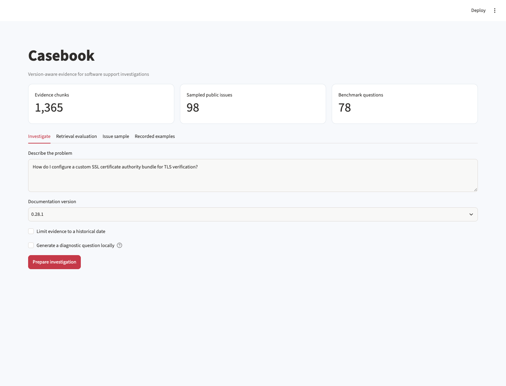

# Casebook

A version-aware investigation workbench for software support. It connects tagged HTTPX documentation and public issue histories to source-linked troubleshooting evidence, with explicit handling of missing information.



[View a cited investigation](docs/investigation.png)

## What it does

- Raw source snapshots, SHA-256 provenance, stable source IDs, and transactional SQLite/PostgreSQL ingestion.
- TF-IDF, MiniLM sentence embeddings, and reciprocal-rank fusion with version and historical availability filters.
- A bounded investigation workflow that quotes evidence, links original sources, and requests missing diagnostic context.
- An optional local Flan-T5 diagnostic-question draft, marked for human review.
- A transparent 78-question retrieval benchmark, per-question failures, latency measurements, and issue-sample analytics.
- Streamlit interface, FastAPI API, scheduled snapshot workflow, PostgreSQL Compose stack, PDF report and standalone interactive chart.

## Run locally

Python 3.12 is the tested runtime.

```bash
python3 -m venv .venv
source .venv/bin/activate
python -m pip install -e '.[dev]' -c constraints.txt
casebook run
streamlit run app.py --server.port 8511
```

Run these commands from this repository. For a non-editable installation or a different working
directory, set `PROJECT_ROOT` to the repository path. Raw downloads, local models and processed
datasets are ignored by Git; the run command regenerates them. Reports are included for review.
Network access is required for first-time public-data/model downloads where applicable.

`constraints.txt` records the dependency versions used in local validation. It is a tested version
constraint set, not a cross-platform hash lock. Ordinary dependency resolution still handles
platform-specific packages. Runtime dependencies are declared in `pyproject.toml`.

## Inspect the evidence

- analysis.pdf — methodology, findings and limits
- metrics.json — measured retrieval and workflow metrics
- retrieval_evaluation.csv — every query/method result
- workflow_evaluation.csv — abstention and quoted-source checks
- investigation_examples.json — supported, unsupported and historical traces
- retrieval_comparison.html — standalone comparison chart

Outputs live in `reports/`. [Read the generated analysis](reports/analysis.md),
[methodology](docs/methodology.md), [data dictionary](data/README.md),
and [validation record](docs/validation.json).

## Data and scope

Public encode/httpx documentation at tags 0.27.2 and 0.28.1, 300 most-recently-updated issue API entries with pull requests removed, and comments from a bounded twelve-issue sample. The first snapshot has 1,365 chunks, 98 issues and 36 comments. Refreshes may change those counts. Public text remains attributed through original URLs. Documentation/source is BSD-3-Clause; models have their own upstream licenses.

Per-source download records store hashes and timestamps. A pre-existing local download is
identified as such if its original retrieval time was not captured. `data/provenance.json`
records the dataset and treatment assumptions. Refresh public sources explicitly when needed;
refreshing can change results.

## Walkthrough

1. Open Investigate and submit the default custom-CA question. Expand the cited excerpts and inspect the original tagged documentation.
2. Ask whether the deprecated proxies argument was removed in 0.28. Compare the evidence with the original changelog.
3. Ask about repairing concrete foundations. The tool should ask for more context rather than give HTTPX advice.
4. Set version 0.28.1 with an evidence cutoff before 2024-12-06. No eligible tagged documentation should be returned.
5. Compare keyword and hybrid retrieval in the evaluation tab. Review the per-query results rather than relying on aggregate recall.

## Validate

```bash
python -m pytest -q
python -m ruff check src tests
python scripts/verify_artifacts.py
```

Unit tests use small, interpretable fixtures. Artifact verification checks reconciliations,
report/workbook structure and generated-file hashes. Generate the data before running the
artifact verifier. The validation record distinguishes executed checks from deployment configuration.

## Container

After generating the project data, build from this repository:

```bash
docker build -t casebook:local .
docker run --rm -p 127.0.0.1:8511:8501 casebook:local
```

The build copies generated local inputs so the application can open them. Rebuild after
regeneration. Docker configuration does not itself establish a hosted deployment. Development
servers bind to local ports in these examples.

## Layout

```text
src/casebook/     analytical code, CLI and application
tests/                correctness and boundary fixtures
data/                 provenance, dictionary and regenerable inputs
reports/              measured results and shareable artifacts
docs/                 methodology, preview and validation evidence
scripts/              standalone artifact verification
```

## Investigation API and PostgreSQL

```bash
casebook investigate "How do I configure SSL certificate verification?" --version 0.28.1
casebook investigate "Was the proxies argument removed in 0.28?" --generative
uvicorn casebook.api:app --host 127.0.0.1 --port 8611
```

The local API has `/health`, `/investigate`, and OpenAPI documentation at `/docs`.
The optional generative backend downloads `google/flan-t5-small`; the default is extractive.

```bash
docker compose up -d db
docker compose run --rm ingest
docker compose up -d app
```

For local Python ingestion into PostgreSQL, set `DATABASE_URL` to a SQLAlchemy
`postgresql+psycopg://...` URL. `CASEBOOK_DB_PASSWORD` overrides the local Compose password.
The scheduled GitHub workflow uploads snapshots as workflow artifacts; it does not publish a site.
No cloud application has been deployed as part of the local build.
